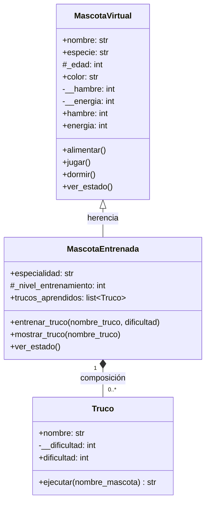

# Proyecto_MascotaV
# Sistema de Gestión de Mascotas Virtuales - Avance 2

Este proyecto amplía el sistema de mascotas virtuales aplicando conceptos avanzados de Programación Orientada a Objetos en Python Encapsulamiento, Herencia, Polimorfismo y Modelado UML.

## Características

- Encapsulamiento Atributos privados (`__hambre`, `__energia`) protegidos con Getters y Setters `@property` que validan rangos de 0 a 100.
- Herencia Subclase `MascotaEntrenada` que extiende a `MascotaVirtual` reutilizando atributos con `super()` y añadiendo nuevos atributos propios (`especialidad`, `trucos_aprendidos`).
- Polimorfismo Sobrescritura (`override`) del método `ver_estado()` en la subclase para mostrar información extendida.

---

## Diagrama UML

